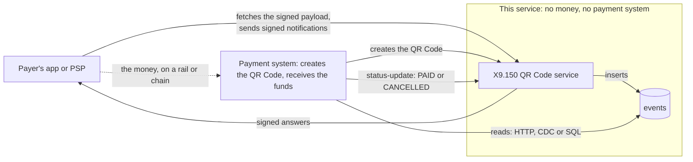
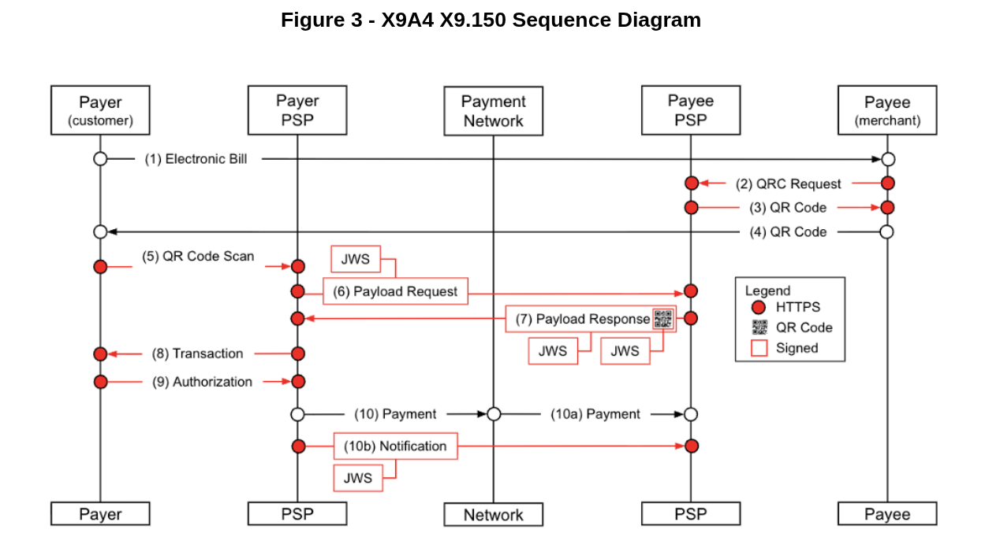

X9 QRCode Backend
========================

This application is a backend implementation of the **ANSI X9.150-2026 Payment QR Code Standard** — it generates and manages merchant-presented payment QR codes across the US bank rails the standard defines — **FedNow, RTP and ACH**, settling in USD — and **Solana**, on the Solana Foundation's published embedding, settling in the dollar stablecoins `USDC` and `FRNT`. Every reading we make of an ambiguous passage in the standard, and every deliberate departure from a literal one, is recorded in [official-spec/INTERPRETATION.md](official-spec/INTERPRETATION.md).

> **History.** The service was first written in Java on MongoDB, and has been rewritten in Go on
> PostgreSQL. [HISTORY.md](HISTORY.md) says why; [BENCHMARK.md](BENCHMARK.md) has the measured
> comparison of the two builds. **The Java build was retired at 3.0.0**
> ([ADR-0039](docs/adr/0039-java-retired-at-3-0-0.md)): `main` holds the Go build only, and the
> Java build stays in the git history under the tag `java-final`, and on Docker Hub as
> `materainc/x9-qrcode:java-final`.
> Moving a 2.x (Java) deployment to 3.0.0? [UPGRADING-TO-3.md](UPGRADING-TO-3.md) says what changes.

## What this software does, and what it does not

**It never touches money.** Read that first, because almost every question about this repository
resolves once it is clear.

**So it never marks a QR Code `PAID`.** It has no means to: it never sees funds arrive, and receiving
and matching money is outside its scope. Only the payment system that receives the funds marks a QR
Code `PAID`, through the status-update API. Nothing a payer sends, in any status, does.

This service does two things: it **raises payment requests** — minting and managing the QR Code a
merchant presents — and it **validates payment notifications** that payers' PSPs send back about
them. That is the whole of it.

| | |
|---|---|
| **It does** | mint QR Codes, publish the signed payload a payer's app fetches, validate notifications against what the QR Code actually asked for, and record what happened as events for the payment system to read |
| **It does NOT** | move funds, receive funds, hold balances, settle, reconcile against a bank or ledger, or pay anyone — including paying out tips to staff |
| **Nor does it** | call a payment system, a core banking system, a rail (FedNow, RTP, ACH), a wallet, a custody provider or a chain node |

**It never touches a payment system either.** The payment system creates the QR Code, receives the
funds and integrates with this service, never the other way round:

- **The payment system creates the QR Code** through the create API, and owns it from then on.

- **This service only records events.** Each status change inserts an event into the
  `payment_event` table in the same transaction. That table is the outbox
  ([ADR-0037](docs/adr/0037-the-event-table-is-the-outbox-read-by-cdc-or-plain-sql.md)).
- **The payment system reads them** through the HTTP event API, or straight from the table, by
  change data capture (Debezium, for example) or by plain SQL
  ([docs/EVENTS-TABLE.md](docs/EVENTS-TABLE.md)).
- **The payment system closes the QR Code** through the status-update API: `PAID` once it has
  matched the money, or `CANCELLED` when it no longer wants the QR Code paid. Only the payment system
  closes a QR Code; nothing a payer says does.
- **The only messages this service sends are X9.150's own:** signed answers to payers, and, when it
  acts for a payer, a signed payment notification to a payee's X9.150 endpoint.



The money travels only on the dotted line, which never crosses this service.

So when a payer reports paying 1100 of which 100 was a tip, this service checks the arithmetic
against the bill, records both figures, and publishes them. **Whether that money arrived is something
only the system using this software can know**, because only it can see the account. That is why
settlement is a status the consuming system sets, not something inferred here, and why the event
stream reports *what was notified* rather than *what was received* — see
[ADR-0014](docs/adr/0014-we-transport-and-sequence-the-consumer-reconciles.md).

The same boundary explains the tip handling. A tip is validated against the range the bill published
and carried through to the event stream split out from the total, so the consuming system can do its
own accounting with it. **Paying the waiter is not this software's business.**

The X9.150 standard itself is copyrighted by ASC X9 and is **not** distributed with this repository. To obtain it, purchase it from the [ANSI Web Store](https://webstore.ansi.org/standards/ascx9/ansix91502026). See [`official-spec/README.md`](official-spec/README.md) for details.

## Stack

| Layer | Choice |
|---|---|
| Language | **Go 1.27** (the toolchain `go.mod` pins, `go1.27.4`); one static, cgo-free binary |
| HTTP | the standard library's `net/http` |
| Database | **PostgreSQL 16** or newer, in one schema, through `pgx/v5` with hand-written SQL; no ORM |
| Schema | a **Liquibase** changelog ([`db/changelog/`](db/changelog/)), run as a one-shot **before** the binary starts, never inside it; see [db/README.md](db/README.md) |
| Signatures | JWS (RFC 7515) with the X9 Financial PKI; see [JWS Signature implementation](#jws-signature-implementation) |
| Configuration | one YAML file plus environment variables ([`cmd/x9-qrcode/config.example.yaml`](cmd/x9-qrcode/config.example.yaml)) |
| JWS | [go-jose v4](https://github.com/go-jose/go-jose) to parse and sign, with the X9.150 profile, PKIX path, CRL and OCSP checks written here (`golang.org/x/crypto/ocsp`); PKCS#12 through `go-pkcs12` |
| EMV | the QR Code's EMV string encoded and decoded by hand ([ADR-0027](docs/adr/0027-crypto-in-go-x9150-jws-profile-pkix-with-crl-and-emv-by-hand.md)) |
| Image | a multi-stage [`Dockerfile`](Dockerfile): the binary on `gcr.io/distroless/static-debian13:nonroot`, non-root, amd64 and arm64 |
| Tests | `go test` (race, shuffled, leak-checked), testcontainers for PostgreSQL and Liquibase, a Python black-box suite ([`others/blackbox/`](others/blackbox/README.md)) |

The service checks at start that it is connected to the schema it expects, with the changelog it
was built for, and refuses to start otherwise.

The prebuilt image is [`materainc/x9-qrcode`](https://hub.docker.com/r/materainc/x9-qrcode) on
Docker Hub, for linux/amd64 and linux/arm64 (see [Pull the prebuilt image](#pull-the-prebuilt-image-docker-hub)).
There is no data migration from the Java build: 3.0.0 starts on an empty database
([ADR-0038](docs/adr/0038-no-data-migration-from-the-java-build-a-written-mapping-instead.md)), and
[docs/CONFIGURATION-FROM-JAVA.md](docs/CONFIGURATION-FROM-JAVA.md) maps every 2.x setting to its key.

The REST APIs are documented in the OpenAPI (Swagger) contract:

- [Official APIs](api/openapi.yaml)

Counterparties integrating against this service should also read
[official-spec/BEST-PRACTICES.md](official-spec/BEST-PRACTICES.md) — advice rather than rules, each
item something that cost somebody real time to discover.

**Provided AS IS.** This software is offered without warranty of any kind. It is source-available under the [Matera Source License v1.0](LICENSE.md) and **may be used and run under the terms of that license** — see [LICENSE.md](LICENSE.md) for the permitted uses and conditions.

# Contributing & Security

Contributions go through pull requests — `main` is protected and every PR needs review. Commits must
be DCO signed off (`git commit -s`); see [CONTRIBUTING.md](CONTRIBUTING.md).

Found a vulnerability? Report it **privately** — see [SECURITY.md](SECURITY.md), not a public issue.

# Project Structure

One Go module at the repository root. Each binary has its own directory under `cmd/`, and each
concern its own package under `internal/`:

```
x9.150-qrcode/
├── cmd/x9-qrcode/           # main.go: wiring, configuration, start and shutdown; config.example.yaml
├── internal/<domain>/       # one package per concern, e.g.:
│   ├── paymentrequest/      #   a biller's API: create, read, PATCH, status update
│   ├── notification/        #   a payer's payment notification, on the payee's side
│   ├── outbound/            #   a payer's notification sent to another payee
│   ├── eventstream/         #   GET /pub/api/v1/events, read from the outbox
│   ├── domain/              #   every lifecycle transition (ADR-0035's map)
│   ├── store/               #   QR Codes, notifications and events in PostgreSQL
│   ├── jws/ pki/ keys/ emv/ #   signing, certificate checks, keystores, EMV by hand
│   └── config/ database/ health/ clock/ httpapi/ …
├── api/openapi.yaml         # the HTTP contract (OpenAPI)
├── db/                      # the PostgreSQL schema: changelog/ (Liquibase), local compose, CI check
├── testdata/                # pki/ (the NON-PRODUCTION test PKI) · lint/ (planted lint violations)
├── Dockerfile               # the image (multi-stage, distroless, non-root)
├── docker-compose.yml       # PostgreSQL 16, Liquibase, then the service (`make up`)
├── docs/                    # adr/ (every decision) · rule coverage · events table · metrics
├── official-spec/           # ANSI X9.150-2026 reference notes (the copyrighted standard — PDF & Markdown — is git-ignored)
├── playground/              # sample create requests and payer/payee simulators
└── others/                  # blackbox/ (the black-box suite) · benchmark/ (k6 harness and results) · helm/ · scripts/ · demo/ · postman/ · doc/
```

A package holds its handler, its rules and its SQL together. There is no DTO or mapper layer: one
structure goes from the wire to the database
([ADR-0024](docs/adr/0024-a-qr-code-is-one-row-and-every-patch-is-audit-logged.md)). Tests sit
next to the code (`*_test.go`); the database tests start PostgreSQL with Docker.

# Running the Application

The service needs **PostgreSQL** with the schema applied by Liquibase **before** it starts. It ships
with a demo signing key and truststore, so it runs out of the box. The demo key is NON-PRODUCTION:
its private key is public. Provide your own X9-issued keys, as PEM or PKCS#12 files, through the `certificate` keys of
[`config.example.yaml`](cmd/x9-qrcode/config.example.yaml) or their environment variables.

> **First time here?** See **[RUNNING.md](RUNNING.md)** for the details: configuration, health,
> shutdown, the test clock and the image.

The quickest way is Docker Compose: PostgreSQL 16, Liquibase, then the service, nothing to install
but Docker.

```bash
make up                                             # builds the image, starts the stack, waits for health UP
make smoke                                          # health + public JWKS on http://localhost:8080
curl -sS -H 'Content-Type: application/json' --data-binary @playground/requests/qr-burger-createqr.json \
  http://localhost:8080/api/v1/payment-request      # create a QR Code
make down                                           # stop, and throw the database away
```

To run the binary on your machine instead, you need Go (the version `go.mod` pins; with the default
`GOTOOLCHAIN=auto`, `go` fetches it) and Docker for the database:

1. **Start a throwaway PostgreSQL 16 and apply the schema.** [`db/docker-compose.yml`](db/docker-compose.yml)
   starts PostgreSQL on `127.0.0.1:55432`, creates the owner role and schema, then runs Liquibase
   once. It trusts every local connection: local use only.
   ```bash
   docker compose -f db/docker-compose.yml up -d --build
   ```

2. **Run the service** as the application role:
   ```bash
   export DATABASE_HOST=127.0.0.1 DATABASE_PORT=55432 DATABASE_NAME=postgres \
          DATABASE_USER=x9_qrcode_app DATABASE_PASSWORD=unused DATABASE_SSLMODE=disable
   make run-local                                      # or: go run ./cmd/x9-qrcode
   #   → API on http://localhost:8080
   ```
   The service refuses to start if it finds the Java build's configuration, including any
   `SPRING_*`, `MONGO*` or `JASYPT_*` variable in the environment. Unset them first.

3. **Throw the database away** when you are done:
   ```bash
   docker compose -f db/docker-compose.yml down -v
   ```

The `make` targets (`make help` lists them all):

```bash
make build               # static binary in bin/x9-qrcode, version and commit stamped
make test                # the Go tests, as CI runs them (the database tests need Docker)
make image               # image x9-qrcode:latest for this machine's architecture (never pushed)
make image-smoke         # the image: non-root, health UP against PostgreSQL, exit 0 on SIGTERM
make image-multiarch     # amd64 + arm64 with docker buildx (no push)
make up / make down      # docker-compose.yml: the whole stack on :8080
make compose-smoke       # the stack on its own project: health, one create, then down
make blackbox-image      # the whole black-box suite against x9-qrcode:latest (IMAGE=… for another)
make helm-check          # lint and render the Helm chart
make publish-dry-run     # build both architectures and verify each, push nothing
```

`make blackbox-image` runs everything in containers: PostgreSQL 16, the schema bootstrap, Liquibase,
the image and the suite
([`others/blackbox/deployment/docker-compose.yml`](others/blackbox/deployment/docker-compose.yml)).

On Kubernetes, deploy with the Helm chart under [`others/helm/x9-qrcode/`](others/helm/x9-qrcode/README.md),
and keep one active instance (see [High Availability](HIGH-AVAILABILITY.md) for the
single-active-instance posture).

### See a whole payment happen

To watch an actual payment rather than a single booted service, run two instances against each
other — one issues a QR Code, the other scans it, announces the payment, pays, and reports it:

```bash
make image
./others/demo/two-instance-payment-cycle.sh                  # x9-qrcode:latest paying x9-qrcode:latest
PAYER_IMAGE=x9-qrcode:latest PAYEE_IMAGE=materainc/x9-qrcode:3 ./others/demo/two-instance-payment-cycle.sh
```

Everything runs in containers: each instance with its own PostgreSQL and the Liquibase changelog,
its own signing key and its own public host, behind an nginx that terminates HTTPS with a throwaway
certificate. CI runs it (the `pairings` job). See [`others/demo/README.md`](others/demo/README.md) —
which also explains why **two deployments cannot transact over plain HTTP**, and how to satisfy that.

### Pull the prebuilt image (Docker Hub)

A multi-architecture image (**linux/amd64 + linux/arm64**) is published on Docker Hub at
[`materainc/x9-qrcode`](https://hub.docker.com/r/materainc/x9-qrcode):

```bash
docker pull materainc/x9-qrcode:3               # the newest 3.x — auto-selects your architecture
docker pull materainc/x9-qrcode:git-<short-sha> # a specific commit (immutable)
X9_IMAGE=materainc/x9-qrcode:3 make up          # run it with PostgreSQL and Liquibase
```

Tags: `latest` (floating), `3`, `3.0`, `3.0.0` (the release line), `git-<short-sha>` (immutable,
pinned to a source commit), and `java-final` (the last Java build, 2.x; no longer maintained).

Each image records the exact source commit it was built from, via standard OCI labels — so you can
always tell which version you're running (and that anything committed after it is *not* in the image):

```bash
docker inspect --format '{{index .Config.Labels "org.opencontainers.image.revision"}}' materainc/x9-qrcode:3
# -> the full git SHA on https://github.com/matera-inc/x9.150-qrcode
```

The image is the service only; it needs PostgreSQL with [`db/changelog/`](db/changelog/) applied
by Liquibase before it starts. `docker-compose.yml` does both; for your own database see
[db/README.md](db/README.md) and [RUNNING.md](RUNNING.md).

# Configuration

The service reads **one YAML file plus environment variables**, which take precedence
([ADR-0031](docs/adr/0031-same-image-lighter-and-3-0-is-a-configuration-migration.md)).
[`cmd/x9-qrcode/config.example.yaml`](cmd/x9-qrcode/config.example.yaml) lists every key and the
variable beside it. Pass the file with `-config <path>` or `X9_CONFIG_FILE`. Where a setting
existed in the Java build, its environment variable kept its name.

- Everything is checked at start. A missing, invalid or unknown key stops the service, naming the
  key and its variable.
- Nothing security-relevant has a default: the database host, user, credential and TLS mode must be
  given.
- The Java build's configuration (Spring YAML, Jasypt `ENC(…)`, `SPRING_*` or MongoDB variables) is
  refused at start, not half-read; the error names
  [docs/CONFIGURATION-FROM-JAVA.md](docs/CONFIGURATION-FROM-JAVA.md), which maps every Java setting
  to its Go key and variable (there is no converter,
  [ADR-0038](docs/adr/0038-no-data-migration-from-the-java-build-a-written-mapping-instead.md)).

[RUNNING.md](RUNNING.md#configuration) explains each group of settings, and
[db/README.md](db/README.md) what the service asks of the database.

The Helm chart is configured with its values files
([`values-minimal.yaml`](others/helm/x9-qrcode/chart/values-minimal.yaml) for a quick start,
[`values.yaml`](others/helm/x9-qrcode/chart/values.yaml) for everything); see the
[Helm deploy](others/helm/x9-qrcode/README.md) guide.

For high availability and how it relates to the license terms, see
[High Availability](HIGH-AVAILABILITY.md).

This service exposes an open, unauthenticated API. Access control is intentionally out of scope — protect it at your edge (API gateway, mTLS, or network policy).

We have a PostMan collection to facilitate the testing of the APIs.

- [PostMan collection](others/postman/postman_collection.json)

# Design & Planning Documents

Architecture, standard-alignment, and integration design notes:

- [History](HISTORY.md) — why the service moved from Java on MongoDB to Go on PostgreSQL, how the change was kept safe, and how Java was retired
- [Upgrading to 3.0.0](UPGRADING-TO-3.md) — what a 2.x (Java) deployment changes to run 3.0.0
- [Benchmark](BENCHMARK.md) — the measured comparison of the two builds, every number as measured
- [Running & Testing](RUNNING.md) — first-run guide: Compose, the binary, Kubernetes, configuration, health, the test clock
- [The database, for a DBA](db/README.md) — the PostgreSQL schema, its roles, and what the service asks of your database
- [The event table](docs/EVENTS-TABLE.md) — reading `payment_event` by change data capture or plain SQL
- [Metrics and actuator endpoints](docs/METRICS.md) — every metric the service exports, and what became of the Java build's; `/actuator/info`
- [Architecture decisions](docs/adr/README.md) — every ADR, including the rewrite's (0022 onwards)
- [Plan: Go + PostgreSQL rewrite](PLAN-GO-POSTGRES-REWRITE.md) — the rewrite's evaluation, phases and benchmark method
- [Endpoints & Local Scan Testing](ENDPOINTS.md) — public/management endpoints, the single-origin URL model, and Cloudflare-tunnel setup for phone-scan testing
- [Two-Instance Payment Cycle](others/demo/README.md) — a whole payment played between two deployments, why HTTPS is mandatory between them, and three ways to provide it
- [Integrating with X9.150](.agents/skills/x9150-integration/SKILL.md) — for developers building software that *uses* this service: call sequences for both roles, the event stream, and what X9.150 deliberately will not do for you
- [QR Code State Machine](STATE-MACHINE.md) — lifecycle states and transitions
- [High Availability](HIGH-AVAILABILITY.md) — application failover and license limits
- [Plan: Non-USD-Pegged Currencies](PLAN-NON-USD-PEGGED-CURRENCIES.md) — request-time FX and per-currency `validUntil` *(proposed)*

> Documents marked *proposed* describe designs that are not yet implemented.

# Performance Testing (k6)

Load tests live in the benchmark harness, [`others/benchmark/`](others/benchmark/README.md). It runs
the same k6 scenarios (S1 create, S2 the full payment cycle, S7 footprint) on Kubernetes, with
fixed resource limits, and records every result. It runs the Go build by default; the Java turns of
a comparison run the `java-final` image. The single-script load test that
used to live under `others/scripts/k6/` was retired: today's API refused every request it sent.

The results, Java on MongoDB against Go on PostgreSQL, are in [BENCHMARK.md](BENCHMARK.md).
Summaries and a SHA-256 checksum of every raw k6 output are committed; the compressed raw outputs
are published on a GitHub release, one per benchmark campaign. The harness README says how to run a
campaign, publish it and verify a download.


# JWS Signature implementation

The section below provides detailed information about the JSON Web Signature (JWS) implementation used in this standard to ensure the integrity and authenticity of messages exchanged between parties.

## Security Overview (JWS)

An X9.150 payment QR Code is **designed to be scanned by an authenticated payment application — not by a phone's camera app**. The QR Code itself carries no payment details; it holds only a reference (a URL and an identifier). To obtain the actual payment payload, the paying application makes an **HTTPS request carrying a JWS**, and the Payee's PSP returns the payment payload **as a JWS**.

Access is gated by the **X9 Financial PKI**: only clients holding a **valid X9-issued certificate** can retrieve and verify the content of a payment QR Code. A camera app — or any client without such a certificate — cannot turn the scanned reference into payment data. Paying a QR Code is therefore expected to be performed by an application that holds (or has access to) an X9-issued certificate.

Every exchange between the Payee's PSP and the Payer's PSP (a bank or fintech) — in both directions, and covering the payload request, the payload response, the QR Code content, and any payment notification — is a **JWS message carried over HTTPS**. Each JWS signature proves the integrity and authenticity of the message, and the shared PKI establishes trust between the parties in real time.

### Objects Requiring Digital Signatures

This standard defines security requirements for four objects:

* **Payment Payload Request:** HTTPS request used to retrieve payment details which is digitally signed using JWS within POST Method

* **Payment Payload Response:** HTTPS response containing JSON-formatted payment information which is digitally signed using JWS

* **QR Code Content:** included in the HTTPS request and response related to Payment Payload and protected within a digitally signed JWS (should be validated upon receipt)

* **Payment Notification** — HTTPS call which is digitally signed using JWS sent by the Payer’s PSP to confirm payment status, if requested by the Payee’s PSP.

### Security Flow

Figure 3 below is a sequence diagram of Figure 1 Biller example.

*  	The (2) QR Code Request and (3) QR Code Response messages between the Payee PSP and the Payee are assumed to be over a secure channel (e.g. HTTPS).
*  	(4) The QR Code is presented to the Payer by the Payee and contains reference information (such as a URL and identifier). Its authenticity and integrity are not validated at scan time; instead, the Payer PSP authenticates the QR Code content upon receiving the (7) Payload Response from the Payee PSP, which returns the full QR Code content, protected within a JWS-signed Payment Payload Response, and the encrypted account number.
*  	(5) When the QR Code is scanned, the Payer’s PSP reads the reference information encoded in the QR Code \- and uses it to determine the protected endpoint to call in order to retrieve the full Payment Payload.
*  	The (6) Payload Request message sent by the Payer PSP to the Payee PSP includes a digital signature which the Payee PSP SHALL verify.
*  	The (7) Payload Response message sent by the Payee PSP to the Payer PSP includes a digital signature which the Payer PSP SHALL verify.
*  	The (10) Payment messages between the Payer PSP, the Payment Network, and the Payee PSP are out of scope of this standard.
*  	The optional (10b) Payment notification sent by the Payer PSP to the Payee PSP includes a digital signature which the Payee PSP SHALL verify.

**Image taken from X9 official specification  \- X9A4 X9.150 Sequence Diagram**



### X9 Financial PKI

ASC X9 has established the X9 Financial PKI, a certificate authority dedicated to financial services and designed to support the QR Code payment framework. This trusted PKI enables participants to obtain X9-issued certificates, validate certificate chains, and verify digital signatures within a common, governed trust ecosystem. More information about X9 Financial PKI can be found [here](https://x9.org/pki-industry-forum/).

### Alternative Encodings (Informative)

This Standard specifies JSON Web Signature (JWS) as the required mechanism for protecting X9.150 messages. Implementations may mutually agree to additionally encapsulate X9.150 messages using alternative formats such as CMS or other ASN.1/XML-based frameworks; however, any such mutually agreed usage is outside the scope of this Standard and is not required for conformance.

When alternative encodings are used:

* All communicating parties should use the same chosen encoding; mixed use (for example, JWS on one side and CMS on the other) will not be interoperable.

* Implementations that choose CMS may use ANSI X9.73 as a reference for encoding conventions.

## JSON Web Signature Overview (JWS)

This standard uses JSON Web Signature (JWS) as defined in RFC 7515 to ensure message integrity and authenticity. JWS is part of the JSON Object Signing and Encryption (JOSE) framework (RFC 7515–7519), which defines how signing metadata is represented in a JWS Protected Header.

### JWS Structure

The JWS structure consists of three Base64Url-encoded components:

Base64Url(JWS Protected Header) . Base64Url(JWS Body) . Base64Url(JWS Signature)

Each object **SHALL** be signed as an independent JWS.

### How Application Data is Transmitted

In a JWS, the application-level JSON data (such as Payment Payload or Payment Notification) is placed directly in the JWS Body. The JWS Body contains the complete application-level data elements as defined in Section 8 (Payment Payload) or Section 9 (Payment Notification).

Transport and security metadata (such as correlation id’s, issued-at, time-to-live timestamps, and http status codes) are included as custom fields in the JWS Protected Header, as permitted by RFC 7515\.

The QR Code content is protected within a JWS object exchanged from the Payee PSP to the Payer PSP.

Through this mechanism, the authenticity and integrity of the QR Code content are proven via the JWS signature, even though the QR Code itself carries no embedded signature fields.

When transmitted within a signed JWS, the qrCodeContent represents a verifiable statement from the Payee's PSP, authenticated under its certificate.

## JWS Protected Header Requirements

The JWS Protected Header **SHALL** include both standard JOSE fields and custom X9.150-specific fields for correlation and replay attack prevention.

### Standard JOSE Header Fields

These fields are defined by RFC 7515 and are required for signature verification:

| Field | Required | Description |
| ----- | ----- | ----- |
| alg | Yes | Signature algorithm. **SHALL** be a value from the X9-approved suite (SD-34). |
| jku, x5u or x5c | Yes | Certificate URL (jku and x5u are preferred) or certificate chain (x5c). Used to provide the public key for signature verification. **Note**: should include X9 Root CA also |
| x5t\#S256 | Yes | SHA-256 thumbprint of the end-entity certificate referenced by x5u or contained in x5c. |
| kid | Yes | Key identifier (free-form string) to aid key rotation if jku is used. |
| typ | Yes | Type field for content-type clarity. **SHALL** be "JOSE" or a profile-specific value (e.g., payreq+jws, payresp+jws, paynote+jws, qr+jws). |

Practical recommendations for implementers (consistent with the field table above):

| Tag | Requirement | Recommendation for Developers |
| :---- | :---- | :---- |
| **alg** | **Mandatory** | Must be ES256 (ECDSA using P-256 and SHA-256). |
| **typ** | **Mandatory** | Use payreq+jws for requests and payresp+jws for responses to prevent cross-protocol attacks. |
| **kid** | **Mandatory** | Must match the kid in the JWKS. This is the primary lookup key for the public key. |
| **jku** | **Recommended** | **The Market Choice.** Points to the .jwks file. If the JWKS contains the certificate in x5c, this is the most efficient method. |
| **x5u** | **Optional** | Only use if the Payer PSP does not support JWKS and needs a direct .pem file link. |
| **x5c** | **Optional** | Use this **inside the JWS header** only if you want to avoid HTTP calls entirely (the certificate is sent with every message). |
| **x5t\#S256** | **Recommended** | Used for **caching**. The receiver checks if they already have this thumbprint in their local database before downloading anything. |

### Custom Header Fields for X9.150

This standard defines the following custom header fields to provide correlation and replay attack prevention:

| Field | Type | Required | Description |
| ----- | ----- | ----- | ----- |
| correlationId | String (UUID) | Yes | UUID created by the requester to correlate request and response. The responder **SHALL** echo back the same correlationId in the response. |
| iat | Integer (Unix timestamp in milliseconds)  | Yes | Issued-at timestamp indicating when the JWS was created. Used to validate message age and detect clock skew. |
| ttl | Integer (Unix time in milliseconds) | Yes | "Time-to-live” duration in milliseconds. The message expires at (iat \+ ttl). Servers **SHALL** reject any request where (current\_time \>= iat \+ ttl). |

To ensure that these fields are correctly processed, the JWS Protected Header **SHALL** include the "crit” (critical) parameter identifying iat and ttl as critical headers.

Example JSON request critical parameter below:

```
"crit”: ["correlationId”, "iat”, "ttl”]
```

If an implementer does not recognize or cannot process any field listed in "crit” it **SHALL** reject the JWS.

Example JWS Protected Headers may be provided in a separate, informative implementation guide.

## JWS Body Structure

The JWS Body **SHALL** contain the application-level JSON data directly. The structure depends on the message type. Payment Payload data elements are defined in Section 8\. Payment Notification data elements are defined in Section 9\.

See Annex A.4 for examples of JWS Body structures.

## JWS Signature Requirements (RFC 7515)

Signatures **SHALL** use JWS (RFC 7515) with a JWS Protected Header as defined in Section 10.5.

### Algorithms

Signature algorithms **SHALL** conform to X9 SD-34, including approved Post Quantum Cryptography (PQC) algorithms as available.

### Trust & Certificates

* Signers SHALL use X.509 certificates issued under the X9 Financial PKI

* Verifiers **SHALL** validate the certificate chain to guarantee that end certificate point to X9-trusted Certificate Authority (CA)

* Revocation and Validity **SHALL** be enforced per X9.150 requirements

## Trust Establishment

When a Request/Response/Notification is received, trust between the communicating PSPs **SHALL** be established through a two-step verification process:

### Transport-Layer Authentication

Both the Payee’s PSP and the Payer’s PSP **SHALL** verify that the HTTPS connection is authenticated with a valid certificate chaining to a trusted root in the X9 Financial PKI.

Connections that fail certificate validation, chain integrity, or revocation checks **SHALL** be rejected.

### Application-Layer Signature Verification

After transport authentication is confirmed, the Payee’s PSP **SHALL** verify the JWS contained in the request/response/notification body using the sender's public key.

This verification step ensures the authenticity and integrity of the payload contents, binding the request data to the authenticated sender identity.

## Signature Verification Process

A verifier **SHALL** perform the following steps:

1. Parse the JWS and extract the Protected Header, Body, and Signature.

2. Validate Critical Header Parameters (crit): Check that all fields listed in crit are understood and can be processed. If any field in crit is not recognized, reject the JWS.

3. Validate Custom Header Fields:

    1. Verify that correlationId is a valid UUID format

    2. Verify that iat is a valid Unix timestamp in milliseconds (UTC)

    3. Verify that ttl is a positive integer within acceptable bounds

    4. For responses, verify that statusCode is present and matches expected HTTP status codes

4. Perform expiration checks of custom header fields (in accordance with Section10.3.2)

    1. The verifier **SHALL** reject any message for which current time \>= iat \+ ttl

    2. The verifier **SHOULD** apply implementation-defined limits on acceptable message age and clock skew when evaluating iat and ttl.

5. Fetch the certificate via x5u (if present) without redirects or authentication, or use x5c

6. Validate certificate validity: Ensure the certificate is not explored or revoked

7. Validate X5t\#S256: Verify that X5t\#S256 matches the SHA-256 thumbprint of the DER-encoded end-entity certificate

8. Validate certificate path: Verify the certificate path to an X9 Financial PKI trust anchor and check validity/revocation (recommended to also validate if payload and certificate was hosted on the same domain).

9. Verify JWS signature: Use the public key in the certificate and the alg parameter specified in the Protected Header

10. Check for duplicate correlationId: The verifier SHOULD verify that this correlationId has not been processed recently.

If any of the above validations fail, the object **SHALL** be rejected.

If verified, transfer verified payload to the application layer.

Note: Caching of certificates via standard HTTP cache headers is RECOMMENDED to avoid downloading the certificate multiple times.

## Digital Signature Responsibility

**Table 5 \- Digital Signature Responsibility Table**

| Object | Signed By | Verified By |
| ----- | :---: | :---: |
| **Payment Payload Request** |  Payer’s PSP or Payer |  Payee’s PSP or Payee |
| **Payload Response** | Payee’s PSP Or Payee | Payer’s PSP Or Payer |
| **QR Code Content (within messages)** | Both PSP’s or Payer/Payee | Both PSP’s or Payer/Payee |
| **Payment Notification** | Payer’s PSP Or Payer | Payee’s PSP Or Payee |


## Application scope

This section describes how the signing mechanism is applied in the context of X9 QRCodes application.

### Bank account networks & protection (US only)

For bank-account payment methods, this implementation supports **US bank rails only** — **FedNow**, **RTP**, and **ACH** (each identified by a 9-digit ABA routing number and an account number).

The `protectionType` field on a bank address is **mandatory**, and it is the **payee's** statement of how the account number is protected (ANSI X9.150-2026 §14.5.x.3): `tokenized`, `encrypted` or `plaintext`. This service stores what was sent and returns it, from GET and in the signed payload; it does not tokenize or encrypt anything itself. Making the field required means anyone reading a payload is told how the account number is protected, never left to assume. `protectionType` applies to the bank rails (FedNow, RTP, ACH) only; a Solana method carries a wallet address, not a bank account.

### The supported network set

**This build interprets four networks: `fednow`, `rtp`, `ach` and `solana`.** Any other key in the networks object — a chain, a private brand, a P2P service — is **refused at creation, with a 400 that names it**. It is not carried verbatim, and it is certainly not dropped in silence: a dropped network looks exactly like a working one from the caller's side, right up until nobody can pay.

**X9.150 specifies the style and the root of a payment method; the inner JSON of each network object belongs to that network's owner.** The standard does not attempt to define, in one document, the format of every payment network in the world — a network's own authority publishes how it is embedded. If Pix is to become an X9.150 payment method for Brazilians, Banco Central do Brasil is the body that publishes how Pix is embedded; the same holds for every chain. Until that publication exists, a typed object for it would be our guess wearing X9.150's name, and would meet a different guess from the next implementer — the interoperability failure the standard exists to prevent. See [ADR-0010](docs/adr/0010-networks-are-interpreted-only-once-their-authority-publishes.md).

Solana is here on the second authority: the **Solana Foundation** published its fields for X9.150 (`recipient` and an optional `memo` — see [official-spec/SOLANA-FIELDS.md](official-spec/SOLANA-FIELDS.md)), which is exactly the bar ADR-0010 sets. Worth knowing how that bar earns its keep: before the publication existed this repository had guessed at a lone `walletAddress` with no memo, and **both halves of the guess were wrong**.

Refusing rather than carrying is a deployment-level judgement on top of that: a network we cannot interpret is one we cannot validate a payment notification against, so a QR Code advertising it is a promise we cannot keep. See [ADR-0012](docs/adr/0012-refuse-what-this-deployment-cannot-honour.md). The supported set is configuration — a network becomes acceptable when it is added to it, never because a caller sent it.

Network keys are **lower-case, always**: `fednow`, `rtp`, `ach`, exactly as §14.5's normative paths spell them. The OpenAPI contract declares them that way, so a caller working from the contract sends lower-case and needs no special handling; a rail written any other way is not one of those properties, lands in `additionalProperties`, and is refused there by name along with every other unsupported network.

The standard's one casing contradiction — §2.4 calls its values “all-uppercase” and then lists `FedNow` — concerns `$.payment.network`, the **value** in a payment notification. That is a different field from these object keys, which §14.5 spells `fednow`/`rtp`/`ach` throughout with no contradiction anywhere. An inbound notification gets the opposite rule: it arrives from a third-party payer whose implementation is not ours to correct, so its rail and currency are matched **case-insensitively** and `$.payment.network` is echoed back **verbatim** — a notification records what somebody claimed. Leniency covers spelling only; a wrong amount, an unoffered currency or an uninterpreted rail is still refused. See [official-spec/INTERPRETATION.md](official-spec/INTERPRETATION.md) I-1.

### Currencies

Monetary amounts are **64-bit integers in a currency's minor units** (never floating-point). The currency is an open string in the payload — an ISO 4217 code such as `USD`/`JPY`, or a digital-asset ticker such as `USDC`/`BTC` — that the module repeats verbatim; the paying PSP resolves its decimals.

What a **deployment** will accept is narrower, because it is decided by the rails: FedNow, RTP and ACH move dollars, and Solana settles two American dollar stablecoins — `USDC` and `FRNT`, the Frontier Stable Token issued by the State of Wyoming through its Stable Token Commission — so `supported-currencies.json` lists all three and a QR Code denominated in anything else — or in the wrong case, `usd` — is refused at creation. An empty list disables the check. All three sit in the same dollar peg group, so one QR Code may carry a USD bank method beside a USDC or FRNT method on Solana. FRNT belongs in that group because it is pegged to the dollar and **redeemable at par** — the peg rule asks whether two amounts denote the same value, not whether two tokens happen to trade at a similar price. That is separate from the allow list: `pegged-currencies.json` says what may appear *together*, `supported-currencies.json` says what is accepted at all.

### Implementation

The Go build parses a JWS with [go-jose](https://github.com/go-jose/go-jose) and runs its own
verification sequence on top: the `crit` header fields, the millisecond `iat` and `ttl`, the
`x5t#S256` thumbprint, and the certificate path with CRL and OCSP revocation checks
([ADR-0027](docs/adr/0027-crypto-in-go-x9150-jws-profile-pkix-with-crl-and-emv-by-hand.md)). The
code is in `internal/jws` (signing and verification), `internal/pki` (trust and revocation) and
`internal/keys` (the keystore and truststore, reloaded from disk). The retired Java build used the
Nimbus JOSE + JWT library; tokens from either build verify on the other, which a golden set
exported from Java ([`others/blackbox/golden/`](others/blackbox/golden/README.md)) still proves on
every run of the suite.

### Configurations

These settings change how signatures are generated and validated. Each is a key of the
`certificate` block of [`config.example.yaml`](cmd/x9-qrcode/config.example.yaml), with its
environment variable (the name the Java build used, `x9.certificate.*` there):

* **`issuer-name`** (`X9_CERTIFICATE_ISSUERNAME`): a counterpart's chain must end at a trust anchor whose issuer contains this, ignoring case. Default: `X9`. Empty skips the check.
* **`endpoint-type`** (`X9_CERTIFICATE_ENDPOINTTYPE`): how a signed JWS points at the certificate. Default: `JWK_SET`.
* **`jwk-algorithm`** (`X9_CERTIFICATE_JWKALGORITHM`): the signing algorithm. `RS256`, `RS384`, `RS512`, `PS256`, `PS384` or `PS512` for an RSA key; `ES256`, `ES384` or `ES512`, each on its own curve, for an EC key. Default: `PS512`. An algorithm the key cannot sign with stops the service at start.

The **endpoint type** defines how the public certificate is exposed on a generated JWS. The options are:
* **`NONE`**: the certificate chain itself, in the `x5c` field
* **`PEM`**: the `x5u` field, the public URL of the chain in PEM (`/pub/.well-known/certificate/x9-key.pem`)
* **`JWK_SET`**: the `jku` field, the public JWK Set URL (`/pub/.well-known/jwks`)

The private key and the truststore are files, configured with these variables:
* `X9_CERTIFICATE_PRIVATEKEYSTORE_LOCATION`: the file holding the private key and its complete certificate chain, as PEM or PKCS#12; a JKS file is refused. Empty: the bundled demo key (NON-PRODUCTION).
* `X9_CERTIFICATE_PRIVATEKEYSTORE_PASSWORD`: the password of a PKCS#12 keystore.
* `X9_CERTIFICATE_PRIVATEKEYSTORE_PRIVATEKEYPASSWORD`: accepted empty or equal to the keystore password, since a PKCS#12 file has one password.
* `X9_CERTIFICATE_TRUSTSTORE_LOCATION`: the truststore, as PEM or PKCS#12. **Notice:** it should contain the X9 Root CA and the X9 intermediate CAs.
* `X9_CERTIFICATE_TRUSTSTORE_PASSWORD`: the password of the truststore.

### Signature Tools and Features

The implementation provides the following API tools and features:

* **POST: /api/v1/signature/generate**: The application can generate JWS using the configured private key and signing algorithm on local environment.
* **POST: /api/v1/signature/validate**: The application can verify signatures on JWS requests using the public key retrieved headers. It checks the integrity and authenticity of the signed components.

## Key Management

* Private signing keys **SHALL** be generated/held by each signer.

* Private signing keys **SHALL NOT** be accessible to X9 or the PKI operator.

* Private keys **SHOULD** be generated and stored in certified HSMs or equivalent secure hardware (encrypted at rest).

* The same entity **MAY** reuse one key/certificate for multiple objects it signs.

* Distinct entities **SHALL** use distinct keys/certs.

Key management methods and controls used with this Standard SHOULD follow industry-accepted practices and the principles defined in relevant X9 key management standards (for example, ANSI X9.69).

Where implementers choose to encapsulate X9.150 messages using Cryptographic Message Syntax (CMS) or other ASN.1/XML-based frameworks for optional or proprietary use cases, they MAY reference ANSI X9.73 for guidance on encoding syntax. Such usage is outside the normative scope of this Standard and does not create additional conformance requirements for X9.150

## JWS Certificate Management

* All signing certificates **SHALL** be issued by the X9 Financial PKI.

* Maximum certificate validity: 18 months.

## Conformance

All certificate issuance, PKI operations, and cryptographic profiles **SHALL** comply with the requirements specified in ANSI X9.150 Financial Services Public Key Infrastructure (PKI) for the Financial Services Industry.

This includes conformance to X9.150’s requirements for:

* Certificate formats

* Trust anchors

* Key usage

* Revocation mechanisms

* Cryptographic algorithm profiles

In addition, protection of QR Code Content and associated payloads using this Standard **SHALL** provide integrity and authenticity properties aligned with those defined in ANSI X9.148 Quick Response (QR) Code – Protection Using Cryptographic Solutions.

# The Java build (retired)

The service was first built in Java 25 on Spring Boot 3.5.x, with MongoDB. It was retired at 3.0.0
([ADR-0039](docs/adr/0039-java-retired-at-3-0-0.md)) and is not on `main`:

- **Source:** the git tag `java-final` (`git checkout java-final`; it builds with `./mvnw clean install`).
- **Image:** `materainc/x9-qrcode:java-final`, which no longer receives fixes.
- **Why and how it was replaced:** [HISTORY.md](HISTORY.md), [BENCHMARK.md](BENCHMARK.md), and
  [UPGRADING-TO-3.md](UPGRADING-TO-3.md) for a 2.x deployment.

---

<sub>Copyright © 2026 Matera Systems, Inc. Licensed under the Matera Source License v1.0 (source-available; not open source) — see LICENSE.md at the repository root. Creating a Derivative Work from this document — by AI/ML generation or by manual re-implementation based on it — is governed by that license (see the "Derivative Work" definition and Annex A).</sub>
