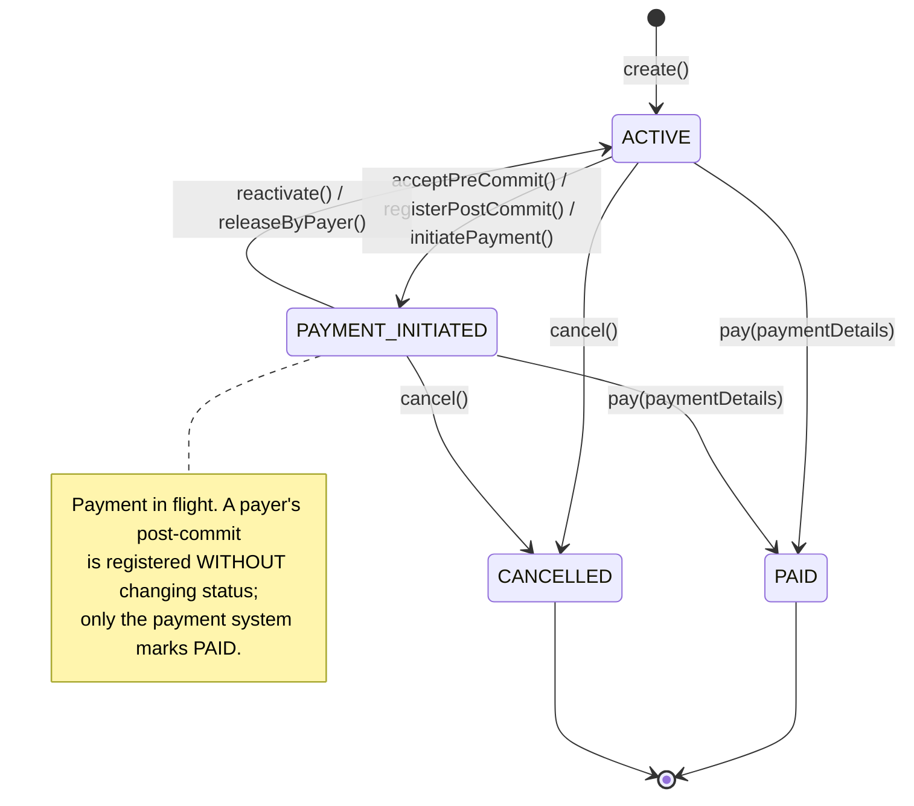
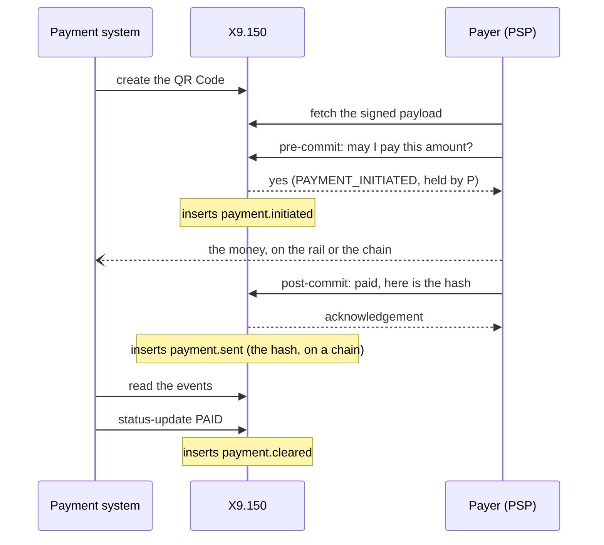
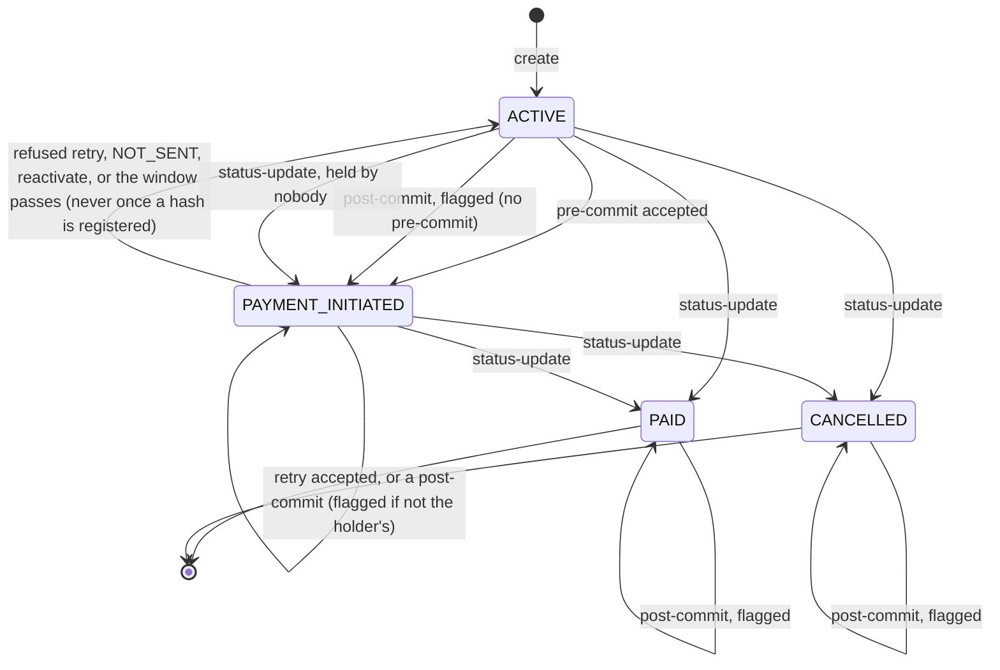

# QR Code State Machine

The lifecycle of a QR Code (payment payload) is modeled by `QRCodeStatusEnum`
(`ACTIVE`, `PAYMENT_INITIATED`, `PAID`, `CANCELLED`) and the transition methods on
`QRCodeEntity` (`pay`, `cancel`, `reactivate`, `initiatePayment`, and the payer
notification methods `admitPreCommit` / `acceptPreCommit`, `registerPostCommit` and
`releaseByPayer`), guarded by `QRCodeEntityValidator`.

## States

| State | Meaning | Terminal |
|-------|---------|----------|
| **ACTIVE** | Created and available for payment (initial state). | No |
| **PAYMENT_INITIATED** | A payment is in flight — announced/initiated but not yet settled. | No |
| **PAID** | Payment settled, as the payment system reported through the status-update API. | **Yes** |
| **CANCELLED** | Payload cancelled by the biller. | **Yes** |

### PAYMENT_INITIATED is held against a clock

A `PAYMENT_INITIATED` QR Code carries the instant its reservation stops counting
(`x9.reservation.ttl-seconds`, environment variable `X9_RESERVATION_TTL_SECONDS`, 90 by
default). **Past that instant it reads as `ACTIVE` again** — a payer who announced and
then vanished cannot lock a bill until `validUntil`, which could be days away for a
code held for seconds.

**`0` means no window** (a bank that wants full control): a reservation never expires,
and ends only by the holder's refused retry, its `NOT_SENT`, or the status-update API
(`ACTIVE`, `PAID` or `CANCELLED`). `0` used to mean "expire at once".

Nothing sweeps. The stored status keeps saying what was last *reported*, and the
lapse is applied when somebody looks, so a reservation expiring at 3am wakes nobody
and writes nothing ([ADR-0019](docs/adr/0019-a-reservation-expires-and-nothing-sweeps.md)).

Consequences that are easy to miss:

- **Expiry is not a status.** A QR Code past its `validUntil` is still `ACTIVE`;
  nothing happened to it, time simply passed. What expiry governs is what *payers*
  may do ([ADR-0020](docs/adr/0020-the-payee-states-the-outcome-of-its-own-receivable.md)).
- **A post-commit is never refused for status reasons.** The money has moved, and
  the window exists to stop a vanished payer locking a bill, not to decide what is
  true about money. See [the matrix](#every-case-by-message-and-status).
- **A registered hash stops the window.** Once any post-commit is registered for a
  `PAYMENT_INITIATED` QR Code, whoever sent it, the reservation stops expiring and the
  holder does not change; only the payment system ends it, through the status-update
  API ([ADR-0036](docs/adr/0036-pre-commit-on-every-rail-and-every-transaction-hash-is-recorded.md)).

## Core lifecycle

### Transition rules (guards)

| Transition | Method | Allowed from | Notes |
|-----------|--------|--------------|-------|
| create → ACTIVE | `create()` | — | Factory; initial status is always ACTIVE |
| → PAID | `pay(paymentDetails)` | ACTIVE, PAYMENT_INITIATED | `paymentDetails` **required** |
| → CANCELLED | `cancel(paymentDetails)` | ACTIVE, PAYMENT_INITIATED | `paymentDetails` **must be null** |
| → ACTIVE | `reactivate(paymentDetails)` | **PAYMENT_INITIATED only** | `paymentDetails` **must be null** |
| → PAYMENT_INITIATED | `initiatePayment()` (status-update) | ACTIVE (effective) | unattributed reservation |
| payer notifications | `admitPreCommit` / `acceptPreCommit`, `registerPostCommit`, `releaseByPayer` | see [the matrix](#every-case-by-message-and-status) | |

`PAID` and `CANCELLED` are terminal: `pay()` and `cancel()` reject them, a pre-commit
or `NOT_SENT` on them is refused, and a post-commit on them is registered without
reopening them.

## Payment notifications

`PaymentNotificationQRCodeUseCase` decides the phase from the evidence and
`QRCodeEntity` applies [the matrix below](#every-case-by-message-and-status)
(`admitPreCommit` / `acceptPreCommit`, `registerPostCommit`, `releaseByPayer`).
`QRCodeEntityValidator` checks only that the notification is well formed for this
QR Code (a rail it offers, a positive amount, `blockchain` on a chain and not on a
bank rail, `payer.info` and `expectedDate` on ACH, a hash on `SENT`).

> **Only the payment system marks a QR Code `PAID`. This software never does.** It
> never sees funds arrive, on any rail or chain. Pre-commits, post-commits, hashes
> and flags are evidence handed to the payment system, which matches each hash
> against what arrived and calls `PUT /api/v1/payment-request/{id}/status-update`,
> which emits `payment.cleared`. Auto-clearing on a payer's say-so would let a payer
> mark a QR Code paid by asserting a transaction.

## Pre-commit and post-commit

A payment notification can arrive at two moments, and each has its own purpose.

- **Pre-commit — before the money moves: "may I pay this amount?"** It is a **request for
  permission**. It goes through the acceptance gate, judged by the payee's clock at
  receipt, and an accepted pre-commit **reserves** the QR Code. Pre-commit is always used: the
  reservation is what stops two payers from paying the same QR Code at the same time.
- **Post-commit — after the money moved: "I paid, here is the reference."** It carries the
  `transactionId` (End-to-End ID, Trace Number, txId / txHash). It is **recorded, never
  judged again** on amount or time: refusing it would not un-move the money.

The evidence that tells them apart is the transaction reference
([ADR-0004](docs/adr/0004-phase-inferred-from-transaction-id.md)):

> **Pre-commit** ⇔ `$.payment.transactionId` is absent.
> **Post-commit** ⇔ `$.payment.transactionId` is present.

The committee rejected an explicit phase marker, so this inference is the only
mechanism the standard leaves. It holds on every rail, Solana included:
`blockchain.action` only corroborates, and decides one thing on its own, `NOT_SENT`.

### What links a payment to its QR Code, per rail

The payee can only mark a QR Code paid if something links the incoming funds to it.
Where the payment itself carries the QR Code id, the post-commit is a courtesy; where it cannot,
the post-commit is the link.

| Rail | Does the payment carry the QR Code id? | Role of the post-commit |
|---|---|---|
| **FedNow / RTP** | Yes: the pacs.008 `CdtrRefInf` reference typed `QRCD` (ANSI X9.150-2026 A.6) | courtesy, plus the principal / tip split |
| **ACH** | Yes: the addenda record `QRCD:[32-digit-id]` (A.7; NACHA confirmation pending) | courtesy |
| **Solana** | Only if the optional memo `{QRCD:"id"}` is set and survives ([SOLANA-FIELDS.md](official-spec/SOLANA-FIELDS.md)). Some custody providers' webhooks do not expose the memo | **the link, in practice** |
| **Any other blockchain**, once interpreted | Most chains carry no memo at all | **the link** — pre-commit / post-commit is the mechanism for every chain |

### Every case, by message and status

This is [ADR-0036](docs/adr/0036-pre-commit-on-every-rail-and-every-transaction-hash-is-recorded.md)'s
matrix, and the code follows it on every rail.

**The happy path.**

**The matrix.** Columns are the QR Code's effective status when the message
arrives; every event the message produces carries it as `receivedInStatus`.

- **ACTIVE**: never reserved, or the reservation's window has passed.
- **Held by the sender**: `PAYMENT_INITIATED`, and the sender is the same payer:
  `payer.info` present on both and equal, and the same certificate subject.
- **Held by someone else**: `PAYMENT_INITIATED`, held by another payer, by nobody
  identifiable (taken through the status-update API), or **the sender sent no
  `payer.info`**: without it there is no telling two payers apart, so they are
  assumed to be different (ADR-0036, replacing ADR-0021's certificate-only fallback).
- **On a chain** means Solana and any chain interpreted later. Bank rails never
  publish `payment.sent`; the QR Code id travels in their payment (`QRCD`).

Messages from a payer:

| Message | ACTIVE | Held by the sender | Held by someone else | PAID or CANCELLED |
|---|---|---|---|---|
| **Pre-commit** (no `transactionId`) | Judged at the payee's clock. Yes: → `PAYMENT_INITIATED` held by the sender, `payment.initiated` (also when it takes over a lapsed reservation). No: 400, nothing changes | A retry, judged again. Yes: window refreshed, no event. No: 400, → `ACTIVE`, reservation cleared (on a chain: `payment.failed`). Once a hash is registered: 409, nothing changes § | 409, nothing changes | 400, nothing changes |
| **Post-commit** (`transactionId` present) | Accepted, never judged: → `PAYMENT_INITIATED` held by the sender; `payment.initiated`, then `payment.sent` on a chain; flagged `RECEIVED_IN_WRONG_STATUS`; the window stops | Accepted, status unchanged; `payment.sent` on a chain; the window stops | Accepted, the holder keeps it; `payment.sent` on a chain, flagged `RECEIVED_IN_WRONG_STATUS`; the window stops | Accepted, status unchanged; `payment.sent` on a chain, flagged `RECEIVED_IN_WRONG_STATUS` |
| **`PAYMENT_INITIATED` with a hash** (chain) | As a post-commit, also flagged `ACTION_CONTRADICTS_HASH` | same | same | same |
| **`SENT` without a hash** (chain) | 400 | 400 | 400 | 400 |
| **`NOT_SENT`** (chain: the payer gives it back) | 400; from the holder of a lapsed reservation: accepted, `payment.failed` | → `ACTIVE`, reservation cleared, `payment.failed`. Once a hash is registered: accepted, nothing changes, flagged `ACTION_CONTRADICTS_HASH` (in the warning; no event) § | 409 | 400 |
| **`NOT_SENT` with a `transactionId`** (chain) | As a post-commit (the evidence decides), also flagged `ACTION_CONTRADICTS_HASH` | same | same | same |

From the payment system (status-update API), and from time:

| Change | ACTIVE | Held by a payer | PAID or CANCELLED |
|---|---|---|---|
| **→ `PAYMENT_INITIATED`** | → `PAYMENT_INITIATED`, held by nobody identifiable; `payment.initiated` | 409 | 409 |
| **→ `PAID`** | → `PAID`, `payment.cleared` | same | 400 |
| **→ `CANCELLED`** | → `CANCELLED`, `payment.cancelled` | same | 400 |
| **→ `ACTIVE`** (reactivate) | 400 | → `ACTIVE`, reservation cleared, no event | 400 |
| **The reservation's window passes** | — | reads `ACTIVE`, nothing written, no event; never once a hash is registered, nor when `ttl-seconds` is `0` | — |

§ **Once a hash is registered, no payer message changes the QR Code's status** (owner,
2026-11-14): money has moved, so only the payment system ends the reservation.

**Losing a concurrent write.** A notification that keeps losing the race after its
re-runs answers 409 "busy" with the current status, never 500.

`validUntil` is not a status. Past it, a pre-commit is refused by the payee's clock
(400); a post-commit is still accepted and registered, because the money has moved.

**`deviations`** (on the events, and in the warning logged for the payer):
`RECEIVED_IN_WRONG_STATUS` when a post-commit reached a QR Code that was not
`PAYMENT_INITIATED` held by this payer; `ACTION_CONTRADICTS_HASH` when
`blockchain.action = PAYMENT_INITIATED` carries a hash. Absent when the payer
followed the rules. The Java document keeps only the latest notification; every
hash survives in the event log as its own `payment.sent`, and two hashes for one QR
Code are the payment system's signal of a duplicate payment.

**The unhappy paths, drawn.** Every arrow is a row of the matrix; a loop changes
nothing but still registers the hash.

**Two payers, one QR Code.** A reservation is held by the payer whose pre-commit won;
the only payment X9.150 authorizes is that one. Two pre-commits that arrive together
both read `ACTIVE`, but only one save can win: the loser reads the QR Code again and
is told `409`.

**`NOT_SENT` is keyed on the action,** not on the transaction reference: its whole
meaning is that no transaction exists and none will. It is the only message by which
a payer can give a reserved bill back
([ADR-0021](docs/adr/0021-a-reservation-knows-who-holds-it.md)).

**`payment.sent` and `payment.failed` fire on chains only.** They report a
transaction on a public ledger, a distinction only a blockchain offers.

### ⚠️ Where a transaction reference goes

There is **no dedicated `txHash` field**. The network-agnostic
`$.payment.transactionId` (ANSI X9.150-2026 §2.5, "Payment Transaction ID") carries
whatever reference the rail uses: the ISO 20022 End-to-End ID for FedNow/RTP, the
Trace Number for ACH, and the on-chain transaction hash for Solana.

## Source references

- States: `x9-qrcode-domain/.../vo/enumerated/QRCodeStatusEnum.java`
- Transitions: `x9-qrcode-domain/.../entity/QRCodeEntity.java` (`pay`, `cancel`, `reactivate`, `initiatePayment`, and the payer-notification block: `admitPreCommit`, `acceptPreCommit`, `registerPostCommit`, `releaseByPayer`)
- Guards: `x9-qrcode-domain/.../entity/validator/QRCodeEntityValidator.java`
- Notification dispatch: `x9-qrcode-application/.../usecase/paymentnotification/PaymentNotificationQRCodeUseCase.java`; the phase: `PaymentNotificationDataVO.phase`
- Transaction ID field: ANSI X9.150-2026 §2.5

---

Copyright © 2026 Matera Systems, Inc. Licensed under the Matera Source License v1.0 (source-available; not open source) — see LICENSE.md at the repository root. Creating a Derivative Work from this document — by AI/ML generation or by manual re-implementation based on it — is governed by that license (see the "Derivative Work" definition and Annex A).
