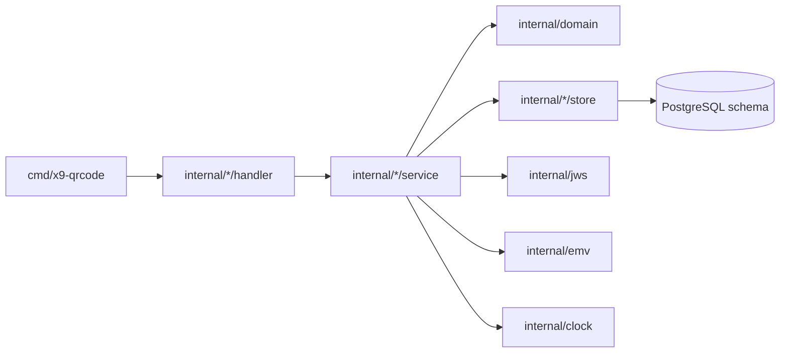
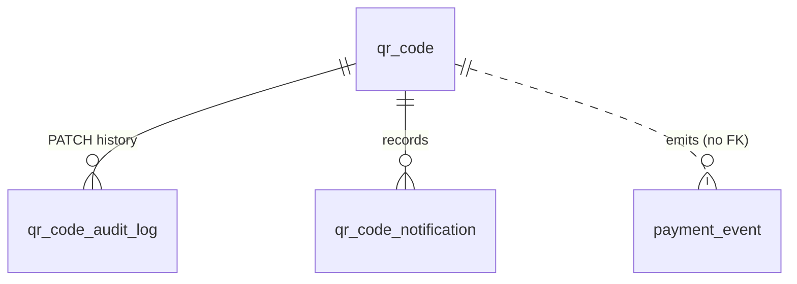

# Architecture Spine — x9-qrcode Go/PostgreSQL rewrite

> **As planned on 2026-11-13, before the Go build was written.** A one-page map of the design and of
> the decisions ADRs 0022–0035 record in full. **The ADRs are the authority**: where this page and an
> ADR differ, the ADR wins. Three decisions changed since; each carries a dated note below (AD-10,
> AD-12, AD-15). How the rewrite went is in [HISTORY.md](../../HISTORY.md).

## Design Paradigm

**Functional core, imperative shell, with one aggregate row.**

- **Shell** (`handler`, `store`): HTTP and SQL I/O.
- **Core** (`domain`): pure decisions over the contract struct, the `qr_code` row and the last
  notification, given `now`.
- **Transaction script:** each use case is one transaction. It reads the row, has the core decide,
  then writes the row, its audit entry and its event together, re-running from the read on a
  conflict.

**Precedence:** the ANSI X9.150 standard first, then the published contract and accepted ADRs,
then Matera's internal engineering standards.



## Invariants & Rules

### AD-1 — Standalone product; precedence of rules [ADOPTED]

- **Binds:** all
- **Prevents:** half the code taking a dependency on platform services, or on a rule that
  contradicts the standard.
- **Rule:**
  - standard > contract and ADRs > internal standards;
  - internal standards are followed in full unless 1 or 2 overrides them;
  - any other deviation needs an ADR;
  - no platform service dependency;
  - configuration is a file plus environment variables;
  - internal standards are never copied into this repository; lint and CI configuration enforce
    them.

### AD-2 — One configurable schema, portable SQL, guest manners [ADOPTED]

- **Binds:** all persistence
- **Prevents:** engine lock-in; privileges or session assumptions a bank's DBA would refuse.
- **Rule:**
  - schema-unqualified SQL; the schema is selected by the application role's own `search_path`,
    and checked with `current_schema()` and the changelog version at startup;
  - Liquibase before the binary;
  - three roles (owner, application, read-only);
  - `READ COMMITTED` set on every transaction;
  - statement and lock timeouts set per transaction (`SET LOCAL`);
  - no session state (PgBouncer ≥ 1.21 in transaction mode);
  - portable dialect, with no recorded exceptions;
  - no transaction spans outbound HTTP;
  - PostgreSQL ≥ 16.

### AD-3 — One row per QR Code; PATCH writes an audit-log entry [ADOPTED]

- **Binds:** create, get, patch
- **Prevents:** versioned reads on the hot path; audit-log key collisions.
- **Rule:**
  - PATCH only from stored `ACTIVE` or `PAYMENT_INITIATED`;
  - PATCH order: read → domain decides → release the holder if rebinding → `UPDATE … WHERE
    lock_version` → `INSERT qr_code_audit_log(id, revision before ++, now, changed_fields,
    previous_values)`;
  - changed tags are those present in the PATCH, plus `paymentMethods` when its value differs;
  - no change → 400;
  - no API reads the audit log.

### AD-4 — One struct from wire to database [ADOPTED]

- **Binds:** handlers, domain, store
- **Prevents:** a DTO, mapper or persistence-model layer reappearing.
- **Rule:**
  - the type decoded from the HTTP body is the one validated, stored in `request_json`, read back
    and signed;
  - enums are typed strings parsed at the boundary;
  - PATCH presence is tracked on the same struct.

### AD-5 — A transition is one transaction, and its event is in it [ADOPTED]

- **Binds:** every state change; `payment_event`
- **Prevents:** events without state (or the reverse); cursor gaps; a payer retrying itself getting
  409.
- **Rule:**
  - conditional `UPDATE` on `lock_version`;
  - on 0 rows, re-run the whole script from the read (up to 3 times), and the re-run decides;
  - any notification row is inserted before the event;
  - an emitting transition **ends** with one batch: `UPDATE event_sequence`, then `INSERT
    payment_event … SELECT last_seq FROM event_sequence`;
  - retry on 40001/40P01/55P03, never 57014; exhausted → 409 *busy*;
  - `lock_timeout` 2 s;
  - separate read and write pools, both on the primary; a parked long-poll holds no connection;
  - no outbox, no drain.

### AD-6 — Identifiers [ADOPTED]

- **Binds:** ids on the wire and in storage
- **Prevents:** format drift between the API, EMV and consumers.
- **Rule:**
  - UUIDs minted by the server (QR Code v7, location v4, event v7);
  - 32 upper-case hex on the wire, lenient on input;
  - the cursor is decimal `seq`;
  - a ULID `after` is translated through `payment_event_legacy_cursor`;
  - no `Idempotency-Key` in the rewrite.

### AD-7 — One clock, movable only in test deployments [ADOPTED]

- **Binds:** domain, jws, store, housekeeping
- **Prevents:** two "nows" in one decision; time rules that cannot be tested.
- **Rule:**
  - all business time comes from `internal/clock`, taken once per transaction;
  - lint forbids the package-level time helpers elsewhere;
  - `/test/clock` exists only with the flag on, on its own listener (loopback by default,
    configurable for CI), and with a compiled-in test-certificate fingerprint; otherwise the
    service refuses to start.

### AD-8 — Business time on read; retention is the only job [ADOPTED]

- **Binds:** status decisions; housekeeping
- **Prevents:** sweepers racing payments; expired codes silently deleted.
- **Rule:**
  - each transition uses the status read named in AD-14's map: effective, or stored for `pay`,
    `cancel` and location release;
  - expiry never writes a status and never deletes;
  - one timer purges events (P30D) and QR Codes (P400D, with their audit and notification rows) in
    paced batches;
  - QR Code retention must be at least event retention;
  - no foreign key from `payment_event` to `qr_code`.

### AD-9 — X9.150 crypto profile [ADOPTED]

- **Binds:** `internal/jws`, `internal/emv`, `internal/keys`
- **Prevents:** a seconds-vs-milliseconds `iat`/`ttl` bug; drift in revocation behaviour.
- **Rule:**
  - sign with go-jose `WithCritical`;
  - verify on our own path: `ParseSignedCompact` with an algorithm allow-list, split the compact
    string for the raw header (integer `iat`/`ttl`), check `crit`,
    resolve and check the certificate, then verify with the standard library;
  - revocation: CRL, then OCSP fallback, soft-fail, end-entity only;
  - safe certificate fetch, cached by thumbprint;
  - keys are PKCS#12 or PEM behind `crypto.Signer`;
  - EMV is hand-written TLV with CRC16;
  - the Java golden corpora must pass.

### AD-10 — Contract frozen; equivalence by a differential run [ADOPTED]

> *Amended 2026-11-17 ([ADR-0039](../adr/0039-java-retired-at-3-0-0.md)):* the differential run proved
> equivalence until 3.0.0, when the Java build was retired from `main`. Its record is
> `others/blackbox/TOLERATED-DIFFERENCES.md`; it can be re-run against the `java-final` image.

- **Binds:** all HTTP; health; metrics
- **Prevents:** a rewrite that is also a breaking change; silent Jackson-vs-Go drift.
- **Rule:**
  - the same suite runs against Java and Go, and normalised responses must match except for the
    entries in `TOLERATED-DIFFERENCES.md`;
  - `NON_NULL` semantics, `violations` texts, case-sensitive keys and `If-Match` parsing are
    reproduced;
  - one `ETag(row, now)`;
  - `errorCode` and `Idempotency-Key` come after cutover.

### AD-11 — Behaviour is defined by the black-box suite [ADOPTED]

- **Binds:** acceptance of every phase
- **Prevents:** rules lost in translation.
- **Rule:**
  - `others/blackbox` (Python, under the repository's licence) is green on Java first;
  - database checks go through the read-only role, and are optional and build-specific.

### AD-12 — Same image, configuration migration [ADOPTED]

> *Amended 2026-11-16 ([ADR-0038](../adr/0038-no-data-migration-from-the-java-build-a-written-mapping-instead.md)):*
> no converter and no `-migrate` image were built; every Java setting is mapped to its Go setting in
> [CONFIGURATION-FROM-JAVA.md](../CONFIGURATION-FROM-JAVA.md).

- **Binds:** packaging, deployment, operations
- **Prevents:** operators broken by a silent `:latest` move or by unreadable old configuration.
- **Rule:**
  - same image name;
  - `3.x` tags, plus an immutable `java-final`;
  - documented environment variables keep their names;
  - Spring or MongoDB configuration makes the service refuse to start, naming `x9-config-convert`;
  - built with the Go toolchain and one multi-stage `Dockerfile` (`docker buildx`, amd64 + arm64,
    distroless static by digest; the migrate image is a second target); the `Makefile` stays a
    thin wrapper;
  - one instance (`Recreate`, no HPA);
  - HTTP timeouts, graceful shutdown, readiness (database + schema check), and "cursor ahead of
    log" → 409 are as stated in ADR-0031;
  - actuator: health, prometheus and info only;
  - Liquibase 4.33.0.

### AD-13 — One owner per column [ADOPTED]

- **Binds:** create, patch, every transition, x9-migrate
- **Prevents:** a stale `emv_content` or `valid_until`; two owners of the location; printed codes
  invalidated by a configuration change.
- **Rule:**
  - `request_json` holds bill content only: no location, no lifecycle data;
  - `location_id` is written by create (default: the QR Code id), PATCH and rebind only, always
    together with `emv_content = domain.EMV(location_id, emvConfig)`; nothing else recomputes the
    EMV;
  - `valid_until` is computed from `request_json` by create and PATCH;
  - lifecycle columns are written only by the transitions in AD-14, every one of which sets
    `revised_at`;
  - `location_id` is unique across all rows;
  - a rebind takes a location from a same-creditor holder that is `PAID`, `CANCELLED` or past
    `valid_until`, and releases the holder (fresh random location, its own `lock_version`)
    **before** taking the location, in the same transaction.

### AD-14 — One event builder; the transition map is normative [ADOPTED]

- **Binds:** paymentrequest, notification, events
- **Prevents:** event bodies drifting between packages; emitting on repeats, lapses or reactivates.
- **Rule:**
  - only `domain.BuildEvent` constructs events;
  - the body comes from the last stored notification (newest by v7 id, read after this
    transaction's insert; optional fields from `notification_json`), otherwise from the first
    payment method and the payment details;
  - triggers, allowed-from statuses and events follow the ADR-0035 table exactly.

### AD-15 — Migration writes only what the runtime could have written [ADOPTED]

> *Superseded 2026-11-16 ([ADR-0038](../adr/0038-no-data-migration-from-the-java-build-a-written-mapping-instead.md)):*
> no data migration was built: the Java build had no production users, so a Java deployment starts
> the Go build on an empty database.

- **Binds:** x9-migrate, cutover
- **Prevents:** first-PATCH collisions; sequence collisions; lost undrained events.
- **Rule:**
  - x9-migrate refuses to run if any outbox is non-empty or the schema holds data (seed rows and
    `last_seq = 0` expected);
  - it writes no audit rows;
  - it copies `location_id` and `emv_content` verbatim, and refuses if `domain.EMV` with the
    converted configuration does not reproduce every string;
  - it keeps `eventId`, records the legacy cursors in their own table, and sets `event_sequence` to the maximum `seq`;
  - it ships as a separate image tag;
  - rollback is allowed only until Go accepts its first write of any kind.

## Consistency Conventions

| Concern | Convention |
| --- | --- |
| Naming | tables `qr_code`, `qr_code_audit_log`, `qr_code_notification`, `payment_event`, `event_sequence`; lookups by short code |
| Data & formats | `TIMESTAMP` in UTC; sentinels, not NULL; money as `BIGINT` minor units; JSON numbers on the wire; ids as 32 upper-case hex |
| Errors | problem+json with today's `type` URIs and `violations` |
| Logging | `slog` JSON, with the request's `b3`/`traceparent` ids; never `request_json`, keys or JWS bodies above debug |
| Concurrency | `lock_version`; re-run on 0 rows (each attempt takes a fresh `now`); retry on 40001/40P01/55P03; JWS verification happens once, before the transaction |
| Time per request | one `now` per **request**, passed down; `jws` never reads the clock itself; a request with no transaction (payload GET) still uses one `now` |
| Echoed values | values the contract echoes verbatim (e.g. `$.payment.network`) are kept as received in `notification_json`; typed enums are parsed only for decisions |
| Holder encoding | `reserved_by_payer_info` / `reserved_by_signer_subject` are `''` when there is no holder; `PAYMENT_INITIATED` with `''` = unattributed (status-update) reservation |
| Problem types | one owner: `internal/problem` holds the catalogue of `type` URIs; 0 rows under `If-Match` → 412 |
| Retention | events purged by `seq` (the highest `seq` whose `occurred_at` is past the cutoff, and everything below it), with their `payment_event_legacy_cursor` rows; the retention timer is disabled while test clock control is on |
| Migration exemption | `x9-migrate` is the one writer allowed to set lifecycle columns directly, copying Java's values verbatim |
| Config precedence | environment variables override the config file; `x9-config-convert` writes the file only |
| Known contract text error | `openapi.yaml` says a notification bumps the revision; it does not (ADR-0016). Fixed in the description after cutover, behaviour unchanged |

## Stack

| Name | Version |
| --- | --- |
| Go | 1.27.0 (toolchain go1.27.4) |
| PostgreSQL | ≥ 16 (CI: 16 and the newest major) |
| github.com/jackc/pgx | v5.13.0 |
| github.com/go-jose/go-jose | v4.1.9 |
| github.com/google/uuid | v1.6.0 |
| golang.org/x/crypto (ocsp) | v0.59.0 |
| PgBouncer (when used) | ≥ 1.21 |
| Liquibase (migration image) | 4.33.0 |
| Base image | gcr.io/distroless/static-debian13:nonroot (pinned by digest) |
| k6 (benchmark) | v2.4.0 |
| MongoDB (migration source only) | 7.0.x |

## Structural Seed

```text
cmd/x9-qrcode/          wiring only
cmd/x9-migrate/         separate image tag
cmd/x9-config-convert/  separate image tag
internal/domain/        EMV, BuildEvent, ETag, effectiveStatus, transitions
internal/{paymentrequest,payload,notification,events}/   handler + service + store
internal/{jws,emv,keys,clock,housekeeping,config}/
db/changelog/           Liquibase
legacy/java/            frozen
others/blackbox/        definition of done (+ TOLERATED-DIFFERENCES.md)
```



## Deferred

- **PKCS#11/HSM signer:** waits for a deployment that needs it (plan B2).
- **Relicensing Matera's internal shared Go packages:** plan D4. Until then, reimplemented.
- **Status audit beyond 30-day event retention:** plan Q10.
- **`Idempotency-Key` and `errorCode`:** after cutover, under the contract's versioning policy.
- **ADRs 0003/0006/0007/0011:** unbuilt in Java, and not ported.
- **Tracing exporter:** 3.0.0 only logs trace ids.
- **Engines other than PostgreSQL:** possible, not supported until the suite is green on them.
- **CDC publication of `payment_event`:** open to consumers, not built.

---

<sub>Copyright © 2026 Matera Systems, Inc. Licensed under the Matera Source License v1.0 (source-available; not open source) — see LICENSE.md at the repository root. Creating a Derivative Work from this document — by AI/ML generation or by manual re-implementation based on it — is governed by that license (see the "Derivative Work" definition and Annex A).</sub>
